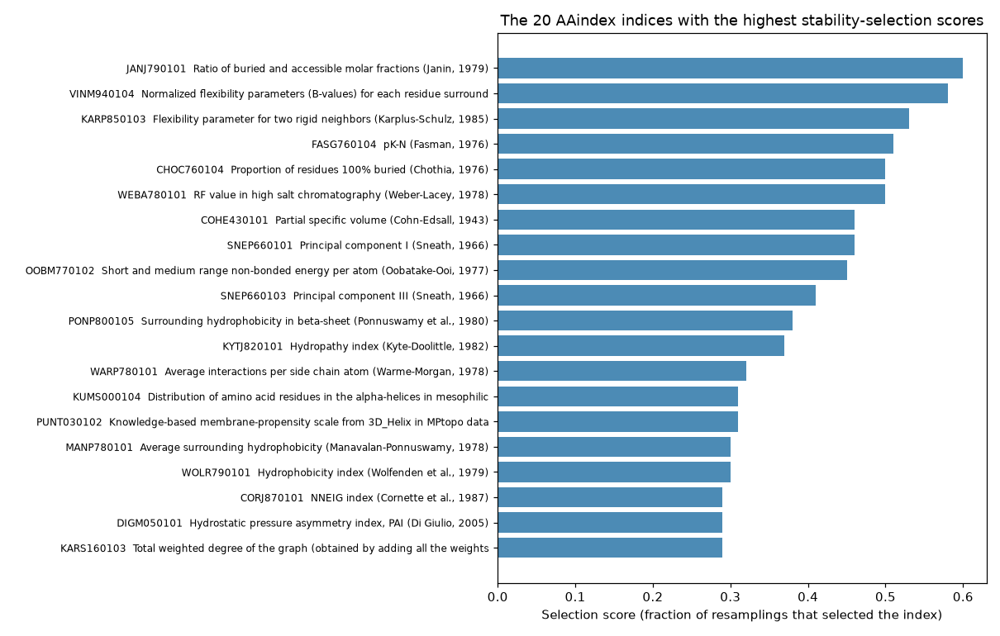

# feature_selection

Which physicochemical properties of amino acids help to tell the residues at a protein–protein interface from the rest? This small study, from February 2018, describes every residue of a set of protein chains with the 553 usable indices of [AAindex](https://www.genome.jp/aaindex/) (hydrophobicity scales, flexibility, burial propensities and so on) and selects the informative ones with stability selection.



## How it works

1. `build_descriptors.py` reads `aaindex1.txt` (AAindex release 9.2). Of its 566 indices, 13 have no value for some amino acid and are skipped, which leaves 553; their accession numbers are written to `total_indices_list.txt`. For each chain in `DB5Sel.fa` it then writes `descriptors/<chain>_descriptors.txt`, one line per residue in SVMlight format: the label (+1 for interface residues, −1 for the others) followed by the 553 index values of the residue's amino acid.
2. `feature_selection.py` loads all the descriptors (`loadSamples.py`) and runs randomised logistic regression, a form of stability selection: logistic regression is fitted on 1,000 random subsamples of the residues with randomly rescaled penalties, and each index scores the fraction of fits that selected it. Indices with a score above 0.05 are kept. The script prints them and plots all the scores in `plot.pdf`.
3. `test.py` redraws the plot from a saved vector of scores, the ones shown in the chart above (drawn by `docs/plot_top_indices.py`).

## Data

| File | Contents |
| --- | --- |
| `DB5Sel.fa` | 314 protein chains, three lines each: `>` and the chain id, the sequence, and one label per residue (`I` for interface residues; `N` and `B` for the other residues) |
| `CAPRI-Blind.fa` | 29 chains in the same format, not used by the scripts |
| `descriptors/` | the descriptors of the 314 chains, as written by `build_descriptors.py` |
| `aaindex1.txt` | AAindex1, the amino acid index database |
| `data_format.txt` | the AAindex file format |
| `list_of_indices.txt` | the 566 indices with their descriptions |
| `total_indices_list.txt` | the 553 indices used |

## Running it

The scripts are written for Python 2.7 and need Biopython, NumPy, SciPy, matplotlib and scikit-learn 0.20 or older: `RandomizedLogisticRegression` was deprecated in scikit-learn 0.19 and removed in 0.21. Run them from the repository root:

```bash
python build_descriptors.py   # rebuilds descriptors/ and total_indices_list.txt
python feature_selection.py   # stability selection, writes plot.pdf
```

`docs/plot_top_indices.py` is the only Python 3 script; it draws the chart above from the scores in `test.py`.

## License

MIT, see [LICENSE](LICENSE). AAindex is distributed by GenomeNet under its own terms.
